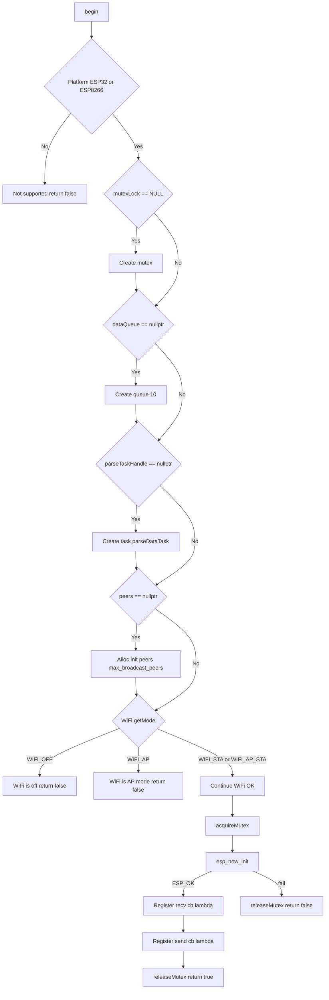
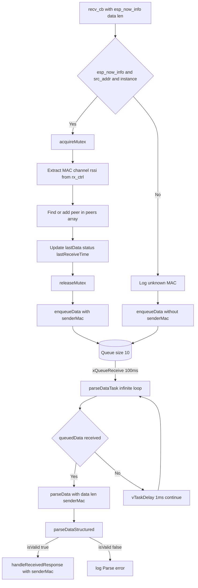
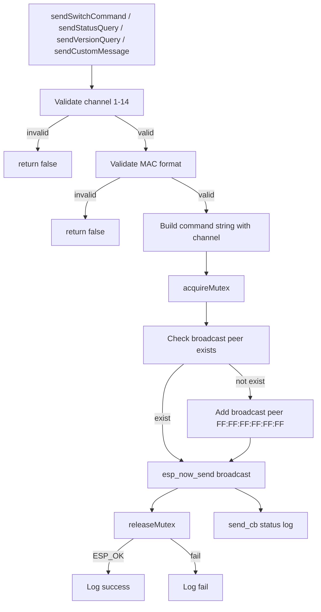
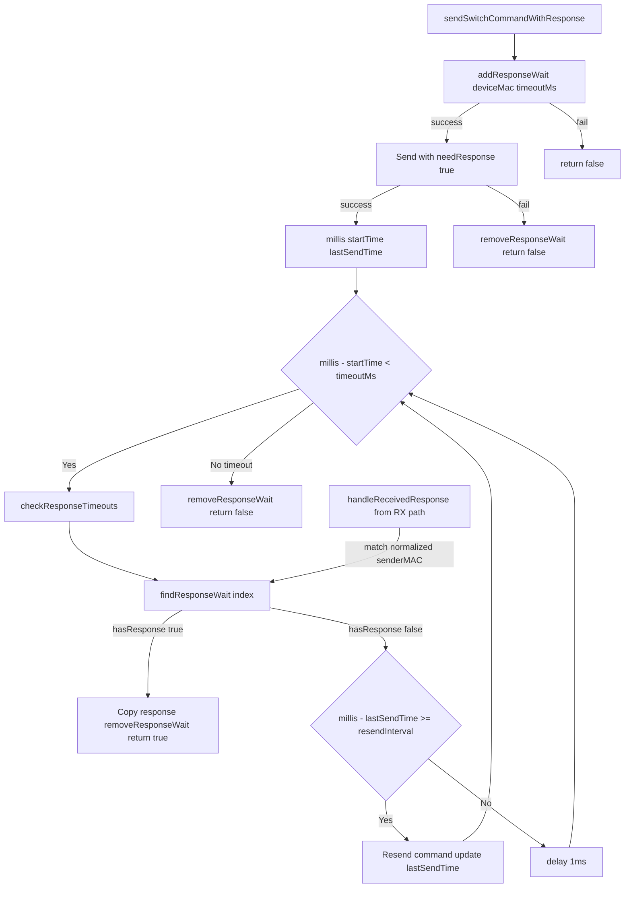
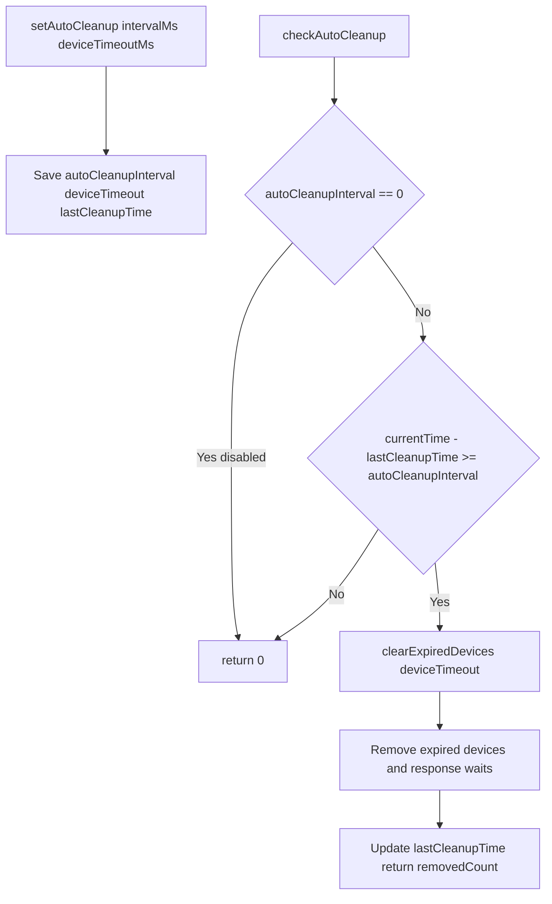
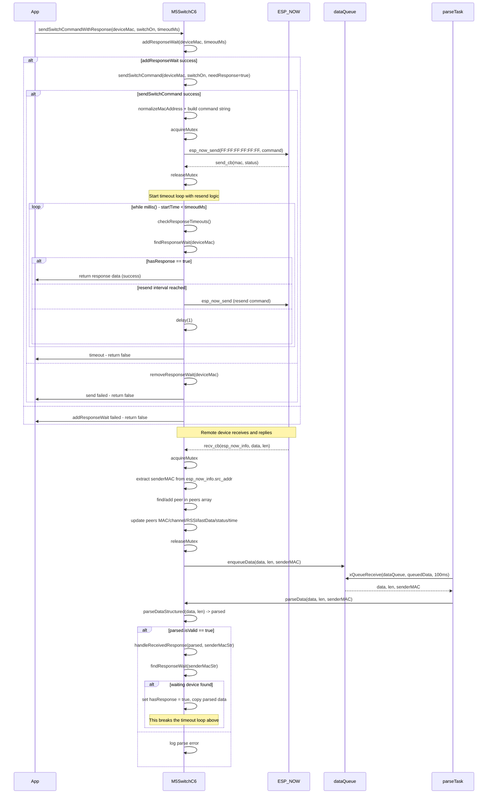

# M5SwitchC6 软件流程图（基于 src/M5Switchc6.cpp）

更新时间：2025-08-13

本文基于 `src/M5Switchc6.cpp` 与 `src/M5Switchc6.h` 提炼核心流程，给出总览流程图与收发应答时序图，帮助理解 ESP-NOW 初始化、数据接收/解析、命令发送与应答等待、设备清理等关键路径。

提示：VS Code Markdown 预览已原生支持 Mermaid。打开本文件后，使用“在侧边打开预览”即可查看图表。

---

## 一、总览流程图

### 1.1 初始化流程 (begin)

### 1.2 接收路径 (回调 -> 队列 -> 解析)

### 1.3 发送路径 (构建命令 -> 发送广播)

### 1.4 应答等待机制 (可选)

### 1.5 自动清理机制 (可选)

说明：

- **初始化流程**：严格按照源码顺序，包含所有条件检查（mutex/queue/task/peers的nullptr检查，WiFi模式的具体枚举值检查）
- **接收路径**：体现了 ESP-NOW 回调的完整处理逻辑，包括 esp_now_info 检查、MAC提取、peers更新、队列入队、解析任务循环
- **发送路径**：包含参数验证（信道范围、MAC格式）、命令字符串构建、广播peer确保存在等完整步骤
- **WithResponse机制**：详细展示了超时循环、重发间隔检查、响应匹配的完整逻辑，以及各种失败情况的处理
- **自动清理**：体现了间隔检查、过期设备移除的完整流程，包括禁用状态的处理

---

## 二、收发与应答时序图

---

## 参考与扩展

- 关键接口：

  - 初始化与通道：`begin()`, `setChannel()`, `getChannel()`
  - 发送：`sendSwitchCommand()`, `sendStatusQuery()`, `sendVersionQuery()`, `sendCustomMessage()`
  - 带应答：`sendSwitchCommandWithResponse()`, `sendStatusQueryWithResponse()`, `sendVersionQueryWithResponse()`
  - 解析：`parseData()`, `parseDataStructured()`
  - 等待/匹配：`addResponseWait()`, `findResponseWait()`, `removeResponseWait()`, `checkResponseTimeouts()`, `handleReceivedResponse()`
  - 清理：`clearPeersData()`, `clearResponseWaits()`, `clearAllData()`, `clearDeviceData()`, `clearExpiredDevices()`, `setAutoCleanup()`, `checkAutoCleanup()`
- 预览方式：

  1) 在 VS Code 中打开本文件
  2) 右上角“在侧边打开预览”（或快捷键 Ctrl+K V）
